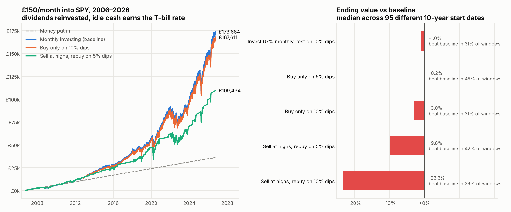
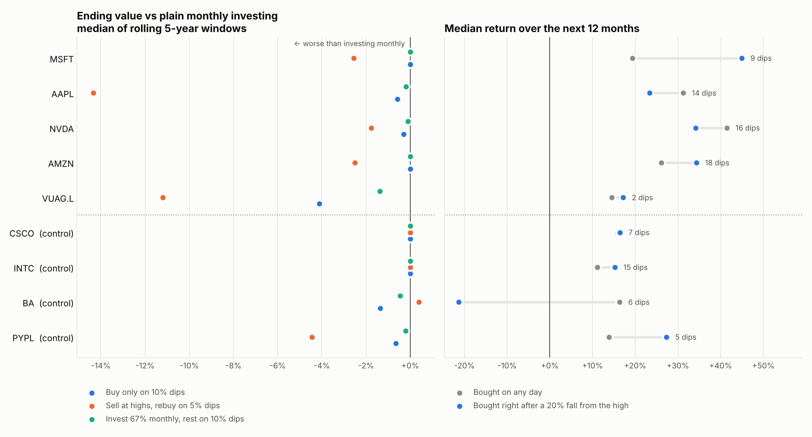

# AI Trading Bot


An AI-assisted investing agent, built in stages. **Stage 1 is a backtester** that tests one question before any money or automation is involved:

> If I put £150 a month into the S&P 500, does waiting for dips (or selling at all-time highs and buying back lower) beat just investing every month?



## Findings (SPY, £150/month)

**Last 20 years (Oct 2006 to Oct 2026):**

| Strategy | Put in | Ended with | Annual return | Avg. time in cash |
|:--|--:|--:|--:|--:|
| Monthly investing (baseline) | £36,150 | **£173,684** | 13.9% | 0% |
| Invest 67% monthly, rest on 10% dips | £36,150 | £171,660 | 13.8% | 3% |
| Buy only on 5% dips | £36,150 | £173,062 | 13.8% | 3% |
| Buy only on 10% dips | £36,150 | £167,611 | 13.6% | 10% |
| Sell at highs, rebuy on 5% dips | £36,150 | £109,434 | 10.0% | 47% |
| Sell at highs, rebuy on 10% dips | £36,150 | £75,545 | 6.9% | 57% |

**Across 95 different 10-year periods** (start dates every 3 months from 1993):

| Strategy | Beat baseline | Median vs baseline | Worst | Best |
|:--|--:|--:|--:|--:|
| Invest 67% monthly, rest on 10% dips | 31% | −1.0% | −4.7% | +0.6% |
| Buy only on 5% dips | 45% | −0.2% | −2.8% | +0.5% |
| Buy only on 10% dips | 31% | −3.0% | −14.0% | +1.8% |
| Sell at highs, rebuy on 5% dips | 42% | −9.8% | −28.1% | +12.9% |
| Sell at highs, rebuy on 10% dips | 26% | −23.3% | −38.8% | +5.2% |

**What this says:**

- **Selling at all-time highs is the expensive part.** Highs come in clusters during long bull runs, so the strategy spends roughly half its time in cash while the market keeps climbing. Over 20 years it ended with about £64k less than plain monthly investing.
- It *can* win when a crash follows soon after (the 2000–02 and 2008 periods are where its "best" windows come from), but that is a bet on timing, and it lost more often and by more.
- **Waiting for dips without selling** costs much less, but still doesn't reliably beat investing straight away. The deeper the dip you wait for, the more you lose.
- Idle cash was given the T-bill rate here, which is generous to the dip strategies. With `--no-cash-interest` they do worse.

## Stage 2: individual stocks

Same question on single stocks: **MSFT, AAPL, NVDA, AMZN** and **VUAG** (Vanguard S&P 500, accumulating, in GBP on the London Stock Exchange). Plus a **control group** of former market leaders: **CSCO, INTC, BA, PYPL**.

The control group matters. The watchlist is made of companies we *already know* became some of the biggest winners in history. Testing "buy the dip" only on them is survivorship bias, so the control group checks what happens when the company you're buying doesn't turn out to be a winner.



### Strategies (rolling 5-year windows)

| Ticker | Buy only on 10% dips | Sell at highs, rebuy on 5% dips | Invest 67% monthly, rest on 10% dips |
|:--|--:|--:|--:|
| MSFT | +0.0% | −2.6% | −0.0% |
| AAPL | −0.6% | **−14.3%** | −0.2% |
| NVDA | −0.3% | −1.8% | −0.1% |
| AMZN | +0.0% | −2.5% | +0.0% |
| VUAG | −4.1% | **−11.2%** | −1.4% |
| *CSCO* | +0.0% | +0.0% | −0.0% |
| *INTC* | +0.0% | +0.0% | +0.0% |
| *BA* | −1.4% | +0.4% | −0.5% |
| *PYPL* | −0.6% | −4.5% | −0.2% |

Median ending value vs plain monthly investing. Full table with win rates: [`results/stocks/report.md`](results/stocks/report.md).

### What happened after a 20% fall from the high

| Ticker | Times | Up 12m later | Median 12m after the dip | Median 12m from any day | Fell another 10%+ within 12m | Longest wait to regain old high |
|:--|--:|--:|--:|--:|--:|--:|
| MSFT | 9 | 88% | +45% | +19% | 25% | 14.4 yrs |
| AAPL | 14 | 64% | +23% | +31% | 71% | 6.4 yrs |
| NVDA | 16 | 67% | +34% | +41% | 73% | 8.4 yrs |
| AMZN | 18 | 76% | +34% | +26% | 65% | 9.8 yrs |
| VUAG | 2 | 100% | +17% | +14% | 50% | 1.6 yrs |
| *CSCO* | 7 | 71% | +16% | +16% | 71% | 21.4 yrs |
| *INTC* | 15 | 77% | +15% | +11% | 46% | 17.5 yrs |
| *BA* | 6 | 33% | **−21%** | +16% | 83% | 7.4 yrs, still waiting |
| *PYPL* | 5 | 60% | +27% | +14% | 80% | 5.0 yrs, still waiting |

**What this says:**

- **Selling at highs is still the costly part**, especially on steady compounders like Apple (−14%) and the S&P 500 fund (−11%).
- **Buying only on dips barely changes anything on single stocks.** Volatile stocks spend most of their time 10%+ below their high, so the dip rule ends up buying almost every month anyway.
- **A 20% fall is not a reliable buy signal.** For Apple and Nvidia, buying right after a 20% fall did *worse* over the next year than buying on a random day. For Microsoft and Amazon it did better. There's no consistent pattern.
- **Most dips kept falling first.** In 65–83% of cases (outside Microsoft), the stock dropped at least another 10% within the year. An alert at −20% often fires too early.
- **Sometimes the dip is the start of a decline.** Boeing was down a median 21% a year after its 20% dips and is still below its old high. Cisco and Intel each took 17–21 years to get back to their 2000 highs. Microsoft took 14.
- **VUAG only exists since 2019** (2 dips), so treat its numbers as thin evidence. Its long-run behaviour is the S&P 500's, which is what Stage 1 tests.

## Stage 3: daily email alerts

`run_monitor.py` checks the watchlist in [`watchlist.json`](watchlist.json) every weekday after the US market closes, using GitHub Actions. When a holding falls past one of its thresholds, it sends an email that puts the dip in context using the Stage 2 history:

> **Microsoft (MSFT) is 20.0% below its high**
> Since 1993, Microsoft has fallen 20% from its high 9 other times. A year later it was higher 88% of the time (median +45% vs +19% from a random day), but 25% of the time it fell at least another 10% first.

- **Stateless.** An alert fires on the day a new dip episode starts (same definition as Stage 2), so the same slide never alerts twice and nothing is stored between runs. It re-arms once the price sets a new high.
- **Alerts, not trades.** It never buys anything. Stage 2 showed a price drop alone is a weak signal, so the email is a prompt to look into it.
- **No secrets in the repo.** Gmail credentials live in GitHub Actions secrets (or a local `.env` file that git ignores).

### Setup

1. **Create a Gmail app password.** Turn on 2-Step Verification for your Google account, then create an app password at [myaccount.google.com/apppasswords](https://myaccount.google.com/apppasswords). It's a 16-character code used instead of your real password.
2. **Add repository secrets** in GitHub under *Settings → Secrets and variables → Actions*:
   - `GMAIL_ADDRESS`: the Gmail account that sends alerts
   - `GMAIL_APP_PASSWORD`: the app password from step 1
   - `ALERT_TO` (optional): where alerts go, if different
3. **Test it.** Go to *Actions → Daily dip alerts → Run workflow* and choose `simulate`. You should get a `[SIMULATED]` alert email within a minute or two.

After that it runs on its own at 22:37 UTC, Monday to Friday. GitHub pauses scheduled workflows in repos with no activity for 60 days, so push a commit now and then (or re-enable it from the Actions tab).

To edit what's watched, change `watchlist.json`. Each ticker has its own thresholds (VUAG uses 5/10/20% because an index moves less than a single stock).

### Run it locally

```bash
cp .env.example .env                              # then fill in your Gmail details
python run_monitor.py --dry-run                   # check prices, save results/alert_preview.html
python run_monitor.py --dry-run --simulate MSFT:0.20   # preview what an alert looks like
python run_monitor.py --always                    # send a real status email to test your setup
```

## How it works

```
src/backtest/
├── data.py        # downloads daily prices (Yahoo Finance) and caches them in data/
├── engine.py      # day-by-day simulation: deposits, buys, sells, cash interest
├── strategies.py  # the strategies compared above
├── compare.py     # single-period and rolling-window comparisons
├── metrics.py     # money-weighted return (XIRR) and summary stats
├── dips.py        # finds every X% fall from the high and what happened next
└── charts.py      # the charts above
src/alerts/
├── monitor.py     # detects new threshold crossings in the latest prices
└── emailer.py     # builds the HTML email and sends it through Gmail
run_backtest.py    # Stage 1: one ticker, strategy comparison
run_stocks.py      # Stage 2: watchlist + control group, strategies and dip episodes
run_monitor.py     # Stage 3: daily check and email alert
watchlist.json     # tickers and alert thresholds
.github/workflows/ # daily-alerts.yml (scheduled check) and tests.yml (CI)
tests/             # pytest unit tests for the engine and metrics
```

Each strategy only sees a `Context` for the current day (price, all-time high so far, how far below it the price is, whether today is a deposit day), so there's no look-ahead bias. Returns are compared with **XIRR**, the money-weighted annual return, because with monthly deposits *when* money goes in matters as much as how much.

**Assumptions:** deposits on the first trading day of each month; dividends reinvested (adjusted prices); fractional shares; no fees or tax; trades at the daily close; deposits treated as the same currency as the index (no GBP/USD effects); idle cash earns the 13-week US T-bill yield.

## Run it

```bash
pip install -r requirements.txt
python run_backtest.py                       # SPY, 20 years + rolling 10-year windows
python run_backtest.py --ticker AAPL         # any Yahoo Finance ticker
python run_backtest.py --monthly 200 --years 15 --window 5 --no-cash-interest
python run_stocks.py                         # Stage 2 watchlist + control group
python run_stocks.py --watchlist MSFT GOOGL --control INTC --window 5
pytest
```

Results are written to `results/` and `results/stocks/` (CSV tables, a markdown report and charts). Run `--refresh` to re-download prices.

## Roadmap

- [x] **Stage 1: Backtester.** Does dip-buying beat monthly investing?
- [x] **Stage 2: Individual stocks.** Same test on a watchlist and a control group, plus what happens after every 10/20/30% fall from the high.
- [x] **Stage 3: Monitor and alert.** Daily GitHub Actions job that emails when a holding crosses a dip threshold, with historical context.
- [ ] **Stage 4: AI layer.** When a threshold trips, Claude reads recent news and explains *why* the stock dropped, to help separate a temporary dip from a company in trouble.
- [ ] **Stage 5: Paper trading.** Execute the strategy on an Alpaca paper account through the Alpaca MCP server, with hard risk limits in code and every decision logged.

*This project is for learning and research. It is not financial advice.*
